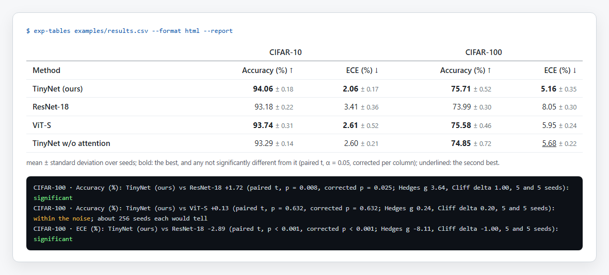

<div align="center">

# exp-tables

**Your results, as the table your paper needs, and only as good as they really are.** exp-tables reads your runs
(CSV, JSON, a wandb export, TensorBoard logs, MLflow), averages every metric over seeds with its spread, tests each
method against the best of its column, and writes the booktabs LaTeX (or Markdown, or HTML) table with the best
in bold — every method the seeds cannot tell apart from the best, not just the one with the highest mean.

<a href="https://github.com/zch6a/exp-tables/actions/workflows/ci.yml"></a>


<a href="LICENSE"></a>

**English** · [简体中文](README.zh-CN.md)

</div>

---

Most results tables are made by hand: copy the numbers, average them, bold the largest. The bold then says "best"
whether the gap is a real improvement or one lucky seed, and the table drifts from the results the first time a run
is redone. exp-tables makes the table from the runs, says which differences the seeds support, and checks that the
table in the paper still matches.

<p align="center"></p>

On [the example](examples/) (made-up results of a made-up paper: four methods, two datasets, five seeds):

```bash
exp-tables examples/results.csv --label "accuracy=Accuracy (%)" --label "ece=ECE (%)" --label method=Method --format markdown
```

| Method | CIFAR-10 · Accuracy (%) ↑ | CIFAR-10 · ECE (%) ↓ | CIFAR-100 · Accuracy (%) ↑ | CIFAR-100 · ECE (%) ↓ |
|---|---:|---:|---:|---:|
| TinyNet (ours) | **94.06** ± 0.18 | **2.06** ± 0.17 | **75.71** ± 0.52 | **5.16** ± 0.35 |
| ResNet-18 | 93.18 ± 0.22 | 3.41 ± 0.36 | 73.99 ± 0.30 | 8.05 ± 0.30 |
| ViT-S | **93.74** ± 0.31 | **2.61** ± 0.52 | **75.58** ± 0.46 | 5.95 ± 0.24 |
| TinyNet w/o attention | 93.29 ± 0.14 | 2.60 ± 0.21 | **74.85** ± 0.72 | <ins>5.68</ins> ± 0.22 |

mean ± standard deviation over seeds; bold: the best, and any not significantly different from it (paired t, α =
0.05, corrected per column); underlined: the second best.

"Ours" has the highest mean everywhere, but on CIFAR-100 accuracy neither ViT-S nor the ablation is significantly
worse with five seeds, so all three are bold. `--report` says what each mark rests on:

```text
CIFAR-100 · Accuracy (%): TinyNet (ours) vs ViT-S +0.13 (paired t, p = 0.632, corrected p = 0.632; Hedges g 0.24,
  Cliff delta 0.20, 5 and 5 seeds): within the noise; about 256 seeds each would tell
CIFAR-100 · Accuracy (%): TinyNet (ours) vs TinyNet w/o attention +0.86 (paired t, p = 0.062, corrected p = 0.125;
  Hedges g 1.23, Cliff delta 0.68, 5 and 5 seeds): within the noise; about 9 seeds each would tell
CIFAR-100 · ECE (%): TinyNet (ours) vs ResNet-18 -2.89 (paired t, p < 0.001, corrected p < 0.001; Hedges g -8.11,
  Cliff delta -1.00, 5 and 5 seeds): significant
```

Bold means "not significantly worse", not "close": on CIFAR-10 ECE, ViT-S (2.61, whose seeds vary a lot) is bold
and the ablation (2.60, steadier) is not, because the ablation's seeds show it is worse and ViT-S's cannot.

The same table as LaTeX is [examples/table.tex](examples/table.tex):

```latex
TinyNet (ours) & \textbf{94.06}\,{\scriptsize$\pm$0.18} & \textbf{2.06}\,{\scriptsize$\pm$0.17} & ...
```

## Install

```bash
uv tool install git+https://github.com/zch6a/exp-tables     # or: pipx install git+https://github.com/zch6a/exp-tables
```

Or run it once: `uvx --from git+https://github.com/zch6a/exp-tables exp-tables results.csv`. No dependencies.

## Use

```bash
exp-tables results.csv                                  # LaTeX, the table worked out from the runs
exp-tables runs/ --format markdown                      # a folder of TensorBoard logs, or an mlruns folder
exp-tables results.csv --rows model --columns task --metrics acc,loss --seed trial
exp-tables results.csv --filter split=test --better perplexity=lower --label acc="Acc. (%)"
exp-tables results.csv --report                         # what each mark rests on
exp-tables results.csv --save-config table.json         # then, any time: exp-tables --config table.json
exp-tables --config table.json --check paper/table.tex  # does the paper's table still match the results?
```

| option | |
|---|---|
| `--rows`, `--columns`, `--metrics`, `--seed` | the layout, when the guess is wrong (rows: method, model, …; column groups: another field that varies; the seed field by its name; every metric) |
| `--filter FIELD=VALUE` | keep only some runs (repeatable) |
| `--better METRIC=higher\|lower` | which way is better, when the name does not say (accuracy, BLEU, F1 up; loss, error, FID, ECE, perplexity down) |
| `--label NAME=TEXT`, `--decimals METRIC=N` | how the table prints names and numbers (default decimals: two significant digits of the spread) |
| `--spread std\|sem\|ci\|none` | after the mean: standard deviation (default), standard error, 95% t interval, nothing |
| `--test auto\|welch\|paired\|wilcoxon\|bootstrap\|none` | the test against each column's best (auto: paired t when the seeds pair up, else Welch's); `--alpha`, `--correction holm\|bh\|none` |
| `--format latex\|markdown\|html\|json` | the output (LaTeX needs `\usepackage{booktabs}`) |
| `--save-config FILE`, `--config FILE` | a config that makes the same table again: inputs (relative to it), filters, the layout as worked out, every option, the version |
| `--check FILE` | compare with a committed table: exit 1 and the lines that differ |

It exits with 0 when the table is made, 1 when `--check` finds a difference, 2 when no table can be made.

## What it reads

| | |
|---|---|
| **CSV, TSV** | one run per row; a column is a metric when all its values are numbers (`93.1%`, `1,234`, `1e-3` too), unless its name is a seed's (seed, trial, fold, …), a configuration's (under `config/`, `params/`, `args/`) or bookkeeping (runtime, timestamps); `--metrics` picks the ones to show. wandb's "Export runs" CSV is one |
| **JSON, JSON Lines** | a list of runs, `{"runs": [...]}`, or runs by name; nested objects flattened (`config/lr`) |
| **TensorBoard** | a folder of runs: each folder with `events.out.tfevents.*` is a run, its path giving its fields (`ours/lr=0.1/seed_2`: method `ours`, `lr` 0.1, seed 2); each tag's value at its last step. Its own reader: no TensorFlow |
| **MLflow** | an `mlruns` folder: parameters and tags as fields, each metric's last value |

## The statistics

Mean and sample standard deviation over seeds; the 95% interval from Student's t. Each column with a direction:
its best against every other method with two or more seeds — the paired t test when both have the same seeds,
Welch's otherwise (or the Wilcoxon signed-rank test, exact up to 25 pairs, or a seeded bootstrap) — with the
column's p values corrected together (Holm by default). Effect sizes: Hedges' g and Cliff's delta. "Seeds needed":
the smallest n for which a difference of the size seen would be found with power 0.8, by the t distribution at n's
own degrees of freedom (paired seeds by the spread of their differences).

Everything is written out in the standard library and checked against independent values (t quantiles against
the published table, the t distribution at fractional degrees of freedom against a numerical integration, exact
Wilcoxon p values by hand).

## In a pull request

Keep the paper's tables in step with the results: when a run is redone, CI says which table is stale.

```yaml
on: [push, pull_request]
permissions:
  contents: read
jobs:
  tables:
    runs-on: ubuntu-latest
    steps:
      - uses: actions/checkout@v4
      - uses: zch6a/exp-tables@v0
        with:
          config: tables/main.json      # made with --save-config
          table: paper/tables/main.tex  # the table the paper \input-s
```

The job summary shows the lines that differ, the table, and what its marks rest on.

## Limits

- It tests what the seeds show. Two seeds a method can rarely show anything; one seed shows nothing (no spread, no
  test), and the table then marks only the highest mean.
- The tests compare each method with the best of its column, not every pair.
- Files are read into memory.

## Also in this toolkit

[paper-proof](https://github.com/zch6a/paper-proof) checks a paper's references and its numbers against its own
tables; [submit-check](https://github.com/zch6a/submit-check) checks it against a venue's rules;
[arxiv-diff](https://github.com/zch6a/arxiv-diff) shows what changed between two versions.

## License

MIT
