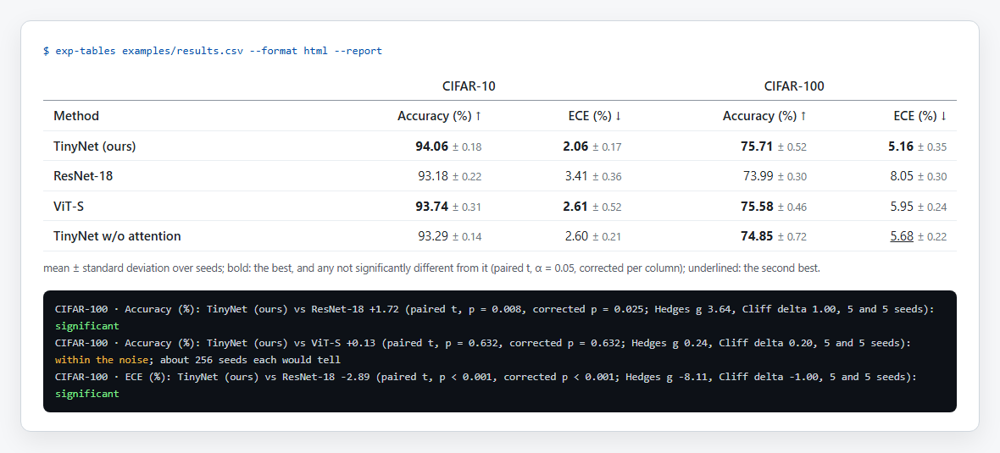

<div align="center">

# exp-tables

**把你的实验结果变成论文需要的表格，而且只说结果真正支持的话。** exp-tables 读取你的运行记录（CSV、JSON、wandb 导出、TensorBoard 日志、MLflow、lm-evaluation-harness 结果），
对每个指标跨种子求均值和波动，把每个方法和该列最佳的方法做显著性检验，然后写出 booktabs LaTeX（或 Markdown、HTML）表格：
加粗的是最佳，以及所有种子无法与最佳区分开的方法，而不只是均值最高的那一个。

<a href="https://github.com/zch6a/exp-tables/actions/workflows/ci.yml"></a>


<a href="LICENSE"></a>

[English](README.md) · **简体中文**

</div>

---

大多数结果表是手工做的：复制数字、求平均、把最大的加粗。于是不管差距是真实的提升还是某个种子运气好，加粗都在说“最佳”；
而且只要重跑一次实验，表格就和结果对不上了。exp-tables 从运行记录直接生成表格，说明哪些差异有种子支持，并检查论文里的表是否仍与结果一致。

<p align="center"></p>

在[示例](examples/)上（一篇虚构论文的虚构结果：四个方法、两个数据集、五个种子）：

```bash
exp-tables examples/results.csv --label "accuracy=Accuracy (%)" --label "ece=ECE (%)" --label method=Method --format markdown
```

| Method | CIFAR-10 · Accuracy (%) ↑ | CIFAR-10 · ECE (%) ↓ | CIFAR-100 · Accuracy (%) ↑ | CIFAR-100 · ECE (%) ↓ |
|---|---:|---:|---:|---:|
| TinyNet (ours) | **94.06** ± 0.18 | **2.06** ± 0.17 | **75.71** ± 0.52 | **5.16** ± 0.35 |
| ResNet-18 | 93.18 ± 0.22 | 3.41 ± 0.36 | 73.99 ± 0.30 | 8.05 ± 0.30 |
| ViT-S | **93.74** ± 0.31 | **2.61** ± 0.52 | **75.58** ± 0.46 | 5.95 ± 0.24 |
| TinyNet w/o attention | 93.29 ± 0.14 | 2.60 ± 0.21 | **74.85** ± 0.72 | <ins>5.68</ins> ± 0.22 |

mean ± standard deviation over seeds; bold: the best, and any not significantly different from it (paired t, α =
0.05, corrected per column); underlined: the second best.

“ours”在每一列的均值都最高，但在 CIFAR-100 的准确率上，五个种子下 ViT-S 和消融版本都没有显著更差，所以三个都加粗。`--report` 说明每个标记的依据：

```text
CIFAR-100 · Accuracy (%): TinyNet (ours) vs ViT-S +0.13 (paired t, p = 0.632, corrected p = 0.632; Hedges g 0.24,
  Cliff delta 0.20, 5 and 5 seeds): within the noise; about 256 seeds each would tell
CIFAR-100 · Accuracy (%): TinyNet (ours) vs TinyNet w/o attention +0.86 (paired t, p = 0.062, corrected p = 0.125;
  Hedges g 1.23, Cliff delta 0.68, 5 and 5 seeds): within the noise; about 9 seeds each would tell
CIFAR-100 · ECE (%): TinyNet (ours) vs ResNet-18 -2.89 (paired t, p < 0.001, corrected p < 0.001; Hedges g -8.11,
  Cliff delta -1.00, 5 and 5 seeds): significant
```

加粗的意思是“没有显著更差”，不是“接近”：在 CIFAR-10 的 ECE 上，ViT-S（2.61，种子间波动大）加粗了，而消融版本（2.60，更稳定）没有，
因为消融版本的种子足以说明它更差，而 ViT-S 的不能。

同一张表的 LaTeX 版本见 [examples/table.tex](examples/table.tex)：

```latex
TinyNet (ours) & \textbf{94.06}\,{\scriptsize$\pm$0.18} & \textbf{2.06}\,{\scriptsize$\pm$0.17} & ...
```

## 安装

```bash
uv tool install git+https://github.com/zch6a/exp-tables     # 或：pipx install git+https://github.com/zch6a/exp-tables
```

只跑一次：`uvx --from git+https://github.com/zch6a/exp-tables exp-tables results.csv`。没有任何依赖。

## 用法

```bash
exp-tables results.csv                                  # LaTeX，表结构从运行记录推断
exp-tables runs/ --format markdown                      # TensorBoard 日志目录，或 mlruns 目录
exp-tables results.csv --rows model --columns task --metrics acc,loss --seed trial
exp-tables results.csv --filter split=test --better perplexity=lower --label acc="Acc. (%)"
exp-tables results.csv --report                         # 每个标记的依据
exp-tables results.csv --save-config table.json         # 之后随时：exp-tables --config table.json
exp-tables --config table.json --check paper/table.tex  # 论文里的表还和结果一致吗？
```

| 选项 | |
|---|---|
| `--rows`、`--columns`、`--metrics`、`--seed` | 推断不对时指定表结构（行：method、model 等；列组：在同一行内取值变化的另一个字段；种子字段按名字或 `seed 42` 这样的取值识别；默认全部指标）。`--columns none` 表示不分组；被读成指标的数字（例如数据比例）也可以写在这里，它就成为运行本身的属性 |
| `--filter FIELD=VALUE` | 只保留部分运行（可重复；`task=arc,gsm8k` 保留其中任一；数字按数值比较：`ratio=0.10` 保留 0.1） |
| `--better METRIC=higher\|lower` | 名字看不出方向时指定（accuracy、BLEU、F1 越高越好；loss、error、FID、ECE、perplexity 越低越好） |
| `--label NAME=TEXT`、`--decimals METRIC=N` | 名称和数字的显示方式（默认小数位：波动的两位有效数字） |
| `--spread std\|sem\|ci\|none` | 均值后面显示：标准差（默认）、标准误、95% t 区间、不显示 |
| `--test auto\|welch\|paired\|wilcoxon\|bootstrap\|none` | 与每列最佳比较所用的检验（auto：种子能配对时用配对 t，否则 Welch）；`--alpha`、`--correction holm\|bh\|none` |
| `--format latex\|markdown\|html\|json` | 输出格式（LaTeX 需要 `\usepackage{booktabs}`；名称会转义，希腊字母写成数学符号；其他非拉丁文字的名称需要文档本身支持） |
| `--save-config FILE`、`--config FILE` | 能再生成同一张表的配置：输入文件（相对配置文件的路径）、过滤条件、推断出的表结构、所有选项、版本 |
| `--check FILE` | 与已提交的表比较：不一致时退出码为 1，并列出不同的行 |

退出码：表格生成为 0；`--check` 发现不一致为 1；无法生成表格为 2。

## 能读什么

| | |
|---|---|
| **CSV、TSV** | 每行一次运行；某列的值全是数字（也认 `93.1%`、`1,234`、`1e-3`）或缺失（空、`nan`、`n/a`、`-`）就是指标，除非它的名字是种子（seed、trial、fold 等）、配置（位于 `config/`、`params/`、`args/` 下，或是超参数名：`lr`、`batch_size`、`weight_decay` 等）或记录信息（运行时长、时间戳、状态）；`--metrics` 选择要显示的指标。数据框的索引列会被忽略。wandb 的 "Export runs" CSV 也是这种格式 |
| **JSON、JSON Lines** | 运行的列表、`{"runs": [...]}`，或按名字组织的运行；嵌套对象会展开（`config/lr`）；`NaN` 和无穷大视为缺失 |
| **lm-evaluation-harness** | 它的结果 JSON（`results_*.json`，Open LLM Leaderboard 公开的就是这种）：每个任务一次运行，字段为 `model` 和 `task`，指标按名字（`acc`、`exact_match (strict-match)`）；给多个文件即可比较模型 |
| **TensorBoard** | 一个包含多次运行的目录：每个含 `events.out.tfevents.*` 的子目录是一次运行，路径给出它的字段（`ours/lr=0.1/seed_2`：method 为 `ours`、`lr` 为 0.1、seed 为 2）；每个 tag 取最后一步的值（记录下来的学习率、epoch 数默认不显示）。自带解析器，不需要 TensorFlow；标量日志每秒约 8 MB |
| **MLflow** | `mlruns` 目录：参数和标签作为字段（MLflow 自己的 `mlflow.*` 标签除外），每个指标取最后的值；已删除的运行不读 |

## 统计方法

跨种子的均值与样本标准差；95% 区间来自 Student t 分布。每个有方向的列：其最佳方法与每个至少有两个种子的其他方法比较——
两者种子相同时用配对 t 检验，否则用 Welch 检验（也可选 Wilcoxon 符号秩检验，25 对以内精确计算、含并列，或固定随机种子的 bootstrap）——
同一列的 p 值一起校正（默认 Holm）。加粗由检验决定：没有显著差于最佳（在有两个以上种子的行中）的行加粗，即使印出来的数字相同也一样。只有一个种子的行无法检验，不作标记，并会提示；整张表都无法检验时，按印出的数字标最佳。效应量：Hedges g 和 Cliff delta。“所需种子数”：以 0.8 的功效检出所见大小差异所需的最小 n，
按 n 自身的自由度用 t 分布计算（配对种子按差值的波动）。

全部用标准库实现，并对照独立数值核对（t 分位数对照公开的表，非整数自由度的 t 分布对照数值积分，Wilcoxon 精确 p 值手算核对）。

## 在 Python 里用

```python
import exp_tables

runs = exp_tables.read("results.csv")            # 也可以是 TensorBoard 目录、mlruns 目录、JSON 文件
table = exp_tables.build(runs, exp_tables.Spec(metrics=["accuracy"], labels={"accuracy": "Acc. (%)"}))
print(exp_tables.latex(table))                   # 或 markdown(table)、html(table)
print(exp_tables.comparisons(table))             # 每个标记的依据
print(table.notes)                               # 运行记录里看起来不对的地方（如果有）
```

`build` 和命令行一样检查表结构（`ValueError` 会说明运行记录里有什么）。过滤、多个输入文件和 JSON 输出由命令行提供。

## 在 Pull Request 里用

让论文里的表和结果保持一致：某次实验重跑后，CI 会指出哪张表过时了。

```yaml
on: [push, pull_request]
permissions:
  contents: read
jobs:
  tables:
    runs-on: ubuntu-latest
    steps:
      - uses: actions/checkout@v4
      - uses: zch6a/exp-tables@v0
        with:
          config: tables/main.json      # 用 --save-config 生成
          table: paper/tables/main.tex  # 论文里 \input 的那张表
```

job summary 里会列出不同的行、表格本身，以及其中标记的依据。

## 局限

- 它检验的是种子所显示的东西。每个方法两个种子很少能说明什么；一个种子什么也说明不了（没有波动、没法检验），这时表里只标出均值最高的。
- 检验是每个方法和该列最佳比较，不是两两全部比较。
- 运行记录看起来不适合这张表时会提示（stderr 和 JSON 里）：同一格里有多个运行用了同一个种子（通常是另一个设置把它们区分开，常常是被读成指标的数字），或 Wilcoxon 检验的配对数太少，永远不可能显著。
- 文件会整个读入内存。十万次运行的表几秒就能生成，但 `--test bootstrap` 是纯 Python 实现，种子数上百时较慢（500 个种子约每次比较 0.2 秒）。

## 同一套工具

[paper-proof](https://github.com/zch6a/paper-proof) 检查论文的参考文献以及正文数字与自身表格是否一致；[submit-check](https://github.com/zch6a/submit-check) 按会议规则检查论文；
[arxiv-diff](https://github.com/zch6a/arxiv-diff) 显示两个版本之间改了什么。

## 许可证

MIT
